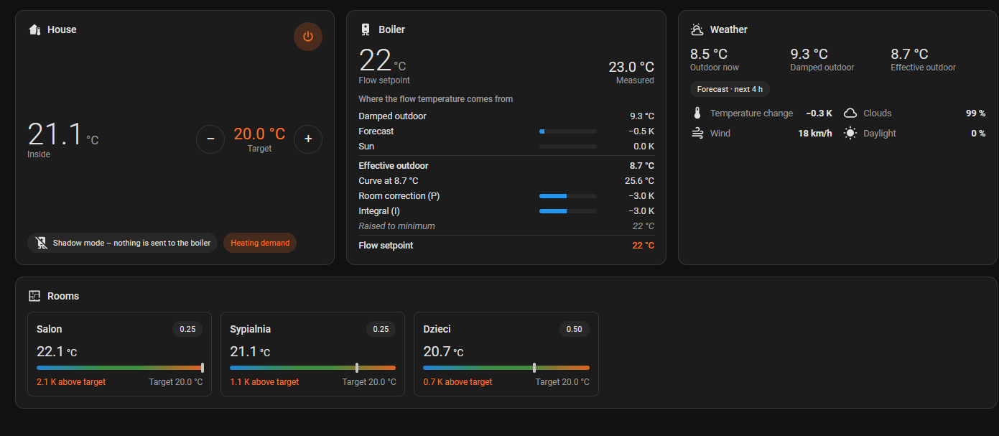
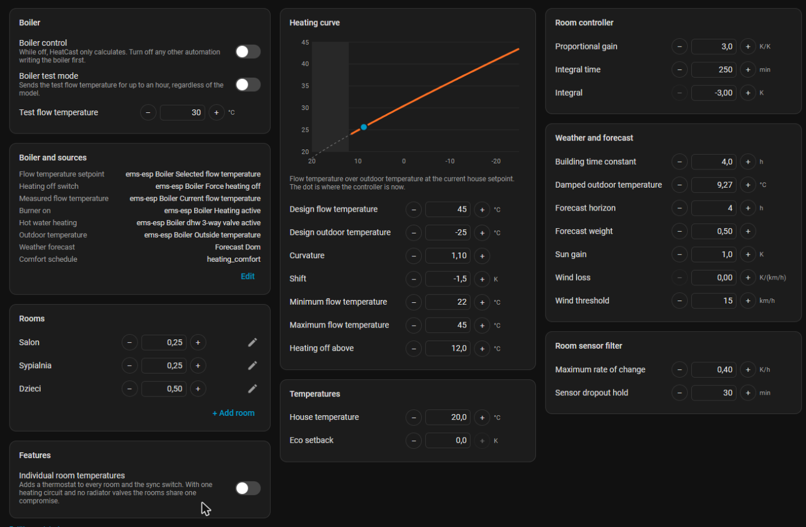

<p align="center">
  
</p>

<p align="center">
  Weather-compensated flow temperature control for Home Assistant, with forecast, sun, wind and room feedback.
</p>

<p align="center">
  <a href="https://github.com/Holczyns/heatcast/actions/workflows/validate.yml"></a>
  <a href="https://github.com/Holczyns/heatcast/actions/workflows/tests.yml"></a>
  <a href="https://hacs.xyz"></a>
</p>

HeatCast replaces a room thermostat that only switches the boiler on and off, or a weather compensator that only
looks at the outdoor sensor. It calculates the flow temperature for the boiler every 30 seconds from:

- the outdoor temperature, damped to follow how slowly the house reacts,
- the hourly forecast, so the heating starts adjusting before the weather changes,
- expected sun and wind,
- the temperature in any number of rooms, weighted by how much each room matters.

It writes the result to any number entity your boiler reads, such as `selflowtemp` from
[EMS-ESP](https://emsesp.org) or an OpenTherm gateway setpoint.



## Features

- **Setup wizard** for the boiler outputs, weather sources, a heating curve with a preview, and rooms.
- **Sidebar panel** showing the house and the rooms, the boiler and a step-by-step breakdown of where the flow
  temperature comes from. Also history, daily burner hours, all settings and a built-in guide.
- **Shadow mode** by default. HeatCast calculates everything but sends nothing until boiler control is switched on,
  so it can be compared with the current control first.
- **Rooms** with weights, a filter that ignores open windows and crowded rooms, and a hold for sensors that drop out
  for a few minutes.
- **Individual room temperatures** (optional), with a sync mode in which all rooms follow the house.
- **Radiator valves**: thermostatic valves get their room target, and optionally the room sensor value as an
  external temperature.
- **Eco setback** applied outside a schedule.
- **Test mode** that sends a fixed flow temperature to check that the boiler accepts it.
- **Built-in guide** covering the switch-over, failure behaviour and curve tuning.



## Requirements

- Home Assistant 2026.10 or newer.
- A boiler that accepts a flow temperature setpoint from Home Assistant, for example through EMS-ESP, an OpenTherm
  gateway or an ESPHome device.
- An outdoor temperature sensor, ideally the boiler's own.
- Optional: a weather integration with an hourly forecast (Met.no works well), temperature sensors in the rooms, a
  schedule helper, a burner sensor.

## Installation

### HACS

1. In HACS, open the menu in the top right corner and choose **Custom repositories**.
2. Add `https://github.com/Holczyns/heatcast` with the type **Integration**.
3. Search for **HeatCast**, download it and restart Home Assistant.
4. Go to **Settings → Devices & services → Add integration** and choose **HeatCast**.

### Manual

Copy `custom_components/heatcast` into the `custom_components` folder of your Home Assistant configuration and
restart Home Assistant.

## Taking over the boiler safely

1. Set the boiler's own fallback (its heating curve or a fixed temperature) and frost protection. Most boilers
   return to it a few minutes after the setpoint stops being refreshed, for example when Home Assistant restarts.
2. Turn off every other automation or thermostat writing the boiler setpoint. Two writers will fight.
3. Turn on **Boiler control** in the panel settings.

Turning boiler control off releases the boiler immediately.

## How it works

```
outdoor sensor ─► damping ─┐
forecast ──────────────────┼─► effective outdoor temperature ─► heating curve ─┐
sun, wind ─────────────────┘                                                    ├─► limits ─► boiler
rooms ─► filter ─► weighted deviation ─► PI room correction ────────────────────┘
```

The heating curve is `T = T_set + (T_design − T_set) · r^(1/n) + offset`, where `r` is the heating load relative to
the design outdoor temperature. The room correction is limited to ±3 K for each of the P and I terms, and the
integral holds while there is no demand, no room data, or the output is already at a limit.

The model lives in `custom_components/heatcast/engine` without Home Assistant imports. A replay test runs recorded
history from a real house through it and checks every value at every five-minute step.

## Development

```bash
# model tests, any Python 3.13+
python -m pytest tests/engine

# integration tests, Python 3.14 with pytest-homeassistant-custom-component (Linux or macOS)
python -m pytest tests

# panel
cd frontend && npm ci && npm run check && npm run build
```

The built panel in `custom_components/heatcast/www` is committed, so installing through HACS needs no build step.

## License

[MIT](LICENSE)
